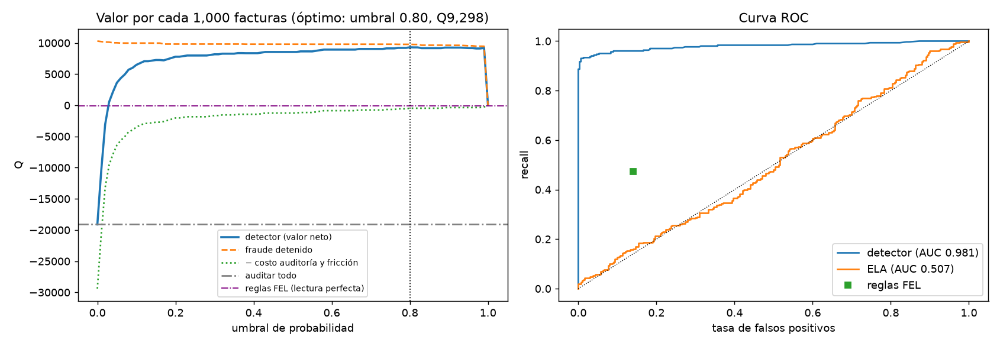

# Resultados

Todas las métricas son sobre el **conjunto de prueba sintético**: 300 facturas auténticas y sus 300 gemelas alteradas, que el modelo no vio al entrenar ni al elegir hiperparámetros. Las figuras y tablas están en [`docs/`](docs/). La evaluación con fotos reales está pendiente (sección final).


*Modelo final (it5) sobre tres fotos de prueba. A la izquierda, el total cambiado de 482.50 a 682.50 (dificultad media). Al centro, el IVA cambiado de 17.83 a 87.83 con la misma fuente (dificultad difícil): el recuadro rojo marca la zona sospechosa, con su acercamiento. A la derecha, una foto auténtica: probabilidad 8.8 %, sin marca.*

## Datos

| | Pares (auténtica + alterada) | Alteraciones fáciles / medias / difíciles |
|---|---|---|
| Entrenamiento | 3,000 | 1,502 / 920 / 578 |
| Validación | 300 | (misma proporción) |
| Prueba | 300 | (misma proporción) |
| Lote extra (it4 e it5) | 3,000 | 903 / 1,036 / 1,061 (con 546 dígitos copiados) |

- **Campos alterados:** total (55 %), NIT del receptor (15 %), fecha (12 %), IVA, NIT del emisor y montos de productos.
- **Técnicas:** reescribir el valor (94 %) o copiar un dígito de la misma factura (6 %).
- **Monto en riesgo:** lo que gana quien altera. Es la diferencia inflada en total o IVA, o el total completo si cambia la fecha (reutilizar una factura vieja) o el NIT (cobrar una compra personal).
- **Las gemelas comparten geometría:** recorte, brillo y escala son los mismos, y solo la compresión JPEG es independiente. Fuera de la zona editada difieren solo por ruido de compresión (2–5 niveles de gris en promedio).

## Iteraciones

| Iteración | Cambio | AUC | Recall con 1 % de falsas alarmas | Recall fácil / medio / difícil* | Localización** | Ahorro (Q / 1,000 facturas) | Entrenamiento |
|---|---|---|---|---|---|---|---|
| it1 | EfficientNet-B0, foto reducida a 768×576, promedio global + capa lineal | 0.950 | 82 % | 95 / 92 / 59 % | — (Grad-CAM 25 %) | 8,213 | 40 min |
| it2 | + mapa de sospecha a 1/16, top-8 y supervisión con máscaras | 0.954 | 87 % | 95 / 95 / 56 % | 71 % | 8,654 | 39 min |
| it3 | + **recortes de 512 a resolución completa** de las gemelas | 0.961 | 90 % | 99 / 97 / 66 % | 80 % | 9,264 | 27 min |
| it3b (ablación) | it3 sin supervisión con máscaras | 0.964 | 90 % | 97 / 95 / 61 % | 0 % (Grad-CAM 5 %) | 9,315 | 22 min |
| it4 | it3 + 3,000 pares extra con más casos difíciles (30/35/35 %, más dígitos copiados), 15 épocas | **0.984** | 91 % | 99 / 96 / **80 %** | 79 % | 9,059 | 77 min |
| **it5 (final)** | datos de it4 + **50 % de recortes sin centrar en la edición** + checkpoint elegido por **recall con 1 % de falsas alarmas**, 10 épocas | 0.981 | **93 %** | 99 / 95 / **80 %** | **87 %** | **9,298** | 41 min |

\* Con umbral 0.5. \*\* Porcentaje de fotos alteradas en las que el punto más sospechoso del mapa cae dentro de la zona editada.

Todos los entrenamientos se hicieron en una RTX 3070 Laptop (8 GB): 10 épocas (15 en it4), AdamW con lr máx. 3e-4 y OneCycle, bf16, y menos de 4 GB de VRAM. La tabla completa está en `docs/comparacion_iteraciones.csv` y las curvas en `docs/curvas_*.png`.

**Incertidumbre:** con 300 alteradas en prueba, un recall cercano al 90 % tiene un intervalo de confianza del 95 % de unos ±3.4 puntos, y una diferencia de ahorro menor a ~Q200 equivale a una o dos facturas del conjunto de prueba. Las diferencias de AUC entre it1, it2 e it3 son consistentes en todas las métricas; entre it3 e it3b, y el ahorro de it3 contra it5, están dentro del ruido.

### Qué aportó cada cambio

- **Resolución completa (it2 → it3)** es el cambio que más mueve el valor (+Q610 por cada 1,000 facturas) y el recall en las alteraciones difíciles (56 → 66 %). Las huellas de una edición (el borde del parche, el ruido distinto, la fuente que no calza) miden unos pocos píxeles; al reducir la foto a la mitad se pierden. Además, entrenar con recortes es *más rápido* (27 contra 39 minutos).
- **Mapa de sospecha + máscaras (it1 → it2)** mejora poco la detección (+0.004 AUC), pero reduce las falsas alarmas a la mitad con umbral 0.5 (3.7 % → 1.7 %) y hace que el modelo señale dónde está la alteración: el mapa acierta la zona en 71 % de los casos, mientras que Grad-CAM sobre el clasificador estándar solo en 25 %.
- **Más casos difíciles (it3 → it4):** es la mejor iteración en métricas técnicas. El AUC sube de 0.961 a 0.984, el recall en alteraciones difíciles de 66 a 80 %, en dígitos copiados de 32 a 63 % y en el IVA de 69 a 85 %. **Pero no genera más valor:** el modelo se vuelve más desconfiado con las facturas auténticas (falsas alarmas con umbral 0.5: 1.7 % → 6.0 %; percentil 95 de la probabilidad en auténticas: 0.11 → 0.62). Para no acusar a empleados honestos hay que subir el umbral a 0.99, y en ese punto el recall queda igual que con it3 (89 %). El ahorro es Q9,059 contra Q9,264. Lo mismo pasa si se supone un fraude real más sofisticado (30/35/35 %): Q7,936 contra Q8,045. Promediar it3 e it4 tampoco mejora (Q9,210). La validación además alcanzó su mejor AUC en la época 5 y bajó después (sobreajuste al lote difícil). Por eso it4 no reemplazó a it3. Es el ejemplo más claro de que la métrica técnica y el valor de negocio no siempre se mueven juntos.
- **Corregir las falsas alarmas de it4 (it4 → it5):** con los mismos datos se hicieron dos cambios dirigidos al problema de it4. Primero, la mitad de los recortes de entrenamiento caen fuera de la zona editada (antes una cuarta parte), así el modelo ve más ejemplos de "esto es normal". Segundo, el checkpoint se elige por el recall con ≤1 % de falsas alarmas en validación, en vez de por AUC: esa métrica se parece a cómo se usa el modelo. it5 **conserva lo que it4 ganó en fraudes difíciles** (80 % de recall en difíciles, 63 % en dígitos copiados, 85 % en el IVA) y **reduce a la mitad su desconfianza con las auténticas** (falsas alarmas con umbral 0.5: 6.0 % → 3.3 %; percentil 95 en auténticas: 0.62 → 0.29). Logra el mejor recall con 1 % de falsas alarmas (93 %) y la mejor localización (87 %). El ahorro es el más alto en la mezcla base (Q9,298 contra Q9,264 de it3) y con fraude más sofisticado (Q8,207 contra Q8,045), aunque esas diferencias están dentro del ruido. **Es el modelo final:** iguala a it3 en valor, es mucho más robusto ante falsificaciones cuidadosas, explica mejor dónde está la alteración y su umbral óptimo (0.80) es menos extremo que el de it3 (0.98).
- **Ablación sin máscaras (it3b):** detecta igual de bien, pero el mapa **deja de señalar la zona editada** (0 % contra 80 %), y Grad-CAM tampoco (5 %). El modelo detecta sin poder mostrar dónde, y eso le quita al auditor la explicación. La supervisión con máscaras no se justifica por la métrica, sino por la explicabilidad, y por eso el modelo final la mantiene.

### Problemas encontrados y cómo se resolvieron

1. **El primer dataset era imposible.** La mitad de las alteraciones copiaban la fuente, la tinta, el ruido y el desenfoque de la foto. Vistas a 768×576 eran indistinguibles del original, incluso para una persona. Los dos modelos se quedaron en AUC 0.50 (loss 0.693, adivinar). La solución fue etiquetar la dificultad (50 % fácil, 30 % media, 20 % difícil), reportar el recall por nivel y bajar la tasa de aprendizaje de 1e-3 a 3e-4.
2. **El post-proceso desalineaba a las gemelas.** Cada foto se recortaba y reescalaba al azar por separado, y así no se podía recortar la misma ventana de las dos. Ahora comparten geometría (`draw_geometry`).
3. **La validación era 35 veces más lenta que el entrenamiento.** Con `channels_last` + bf16, cuDNN arma un plan de ejecución nuevo por cada tamaño de imagen: 1.2 s por foto contra 35 ms sin `channels_last`. Se quitó `channels_last` y los tamaños se redondean a múltiplos de 128.

## Líneas base sin deep learning

| Método | Recall | Falsas alarmas | Ahorro (Q / 1,000) |
|---|---|---|---|
| No revisar nada | 0 % | 0 % | 0 (se pierden Q10,293 de fraude) |
| Auditar todas las facturas | 100 % | 100 % | −19,107 |
| Reglas FEL con **lectura perfecta** de los campos* | 47 % | 14 % | −77 |
| ELA (análisis de nivel de error JPEG) | AUC 0.507 (azar) | | |
| **FacturaSegura (it5, umbral 0.80)** | **93 %** | **0.7 %** | **9,298** |

\* Las validaciones del Proyecto 3 (12/112 del IVA, módulo 11 del NIT, serie y número contra la autorización) aplicadas a los valores que se ven en la foto, suponiendo un OCR perfecto, lo cual favorece a las reglas. Atrapan los totales inflados cuando el IVA no se ajustó, pero no las fechas cambiadas ni un NIT válido de otra persona. Además dan falsas alarmas en facturas legítimas, como las de gasolineras, donde el IDP rompe el 12/112.

ELA no sirve porque todas las fotos, auténticas o no, pasan por recompresión (WhatsApp), lo que borra la huella de la edición.

## Modelo de valor

Por cada 1,000 facturas de reembolso:

```
valor(t) = fraude detenido − costo de auditar las marcadas − fricción con empleados honestos
fraude detenido  = 1000 · prevalencia · E[monto en riesgo · 1(p ≥ t) | alterada]
costo de auditar = 1000 · P(p ≥ t) · Q10           (~10 min de un auditor)
fricción         = 1000 · (1 − prevalencia) · FPR(t) · Q20   (tiempo y molestia del empleado acusado)
```

**Supuestos base:**
- **Prevalencia:** 3 % de las facturas alteradas. Es una estimación; por eso es el parámetro que más se mueve en la sensibilidad.
- **Costos:** Q10 por auditoría y Q20 de fricción por falsa alarma.
- **Monto en riesgo:** sale del propio conjunto de prueba (en promedio Q343 por factura alterada).



**Resultado (it5, umbral óptimo 0.80):** se auditan 34 de cada 1,000 facturas y se detienen Q9,771 de los Q10,293 de fraude (95 %). Restando Q344 de auditoría y Q129 de fricción por las falsas alarmas (0.7 % de las auténticas), el **valor neto es de Q9,298 por cada 1,000 facturas**.

- **Las probabilidades del modelo son muy decididas:** cualquier umbral entre 0.43 y 0.99 da más de Q8,500. Lo que destruye valor son los extremos. Con umbral 0 (auditar todo) se pierden Q19,107, porque la fricción y la auditoría de 970 facturas honestas cuestan más que todo el fraude.
- **Rendimientos decrecientes:** el modelo final ya detiene el 95 % del fraude en quetzales. Aunque llegara al 100 % sin falsas alarmas, el máximo posible sería ≈ Q10,000, apenas +Q700 sobre lo actual. Las iteraciones 3 a 5 lo confirman: el AUC subió de 0.961 a 0.981 y el recall en difíciles de 66 a 80 %, pero el ahorro se movió menos de Q50. Desde aquí, el valor depende más de calibrar bien las probabilidades y de validar los supuestos (prevalencia) que de un modelo más preciso.

**Sensibilidad** (`docs/sensibilidad_it5.csv`): el umbral óptimo se queda en **0.80** en todos los escenarios, salvo con prevalencia de 1 %, donde sube a 0.99. Con tan poco fraude, conviene ser más estricto antes de molestar a alguien, aunque usar 0.80 igual solo cuesta Q99.

| Escenario | Ahorro óptimo (Q / 1,000) | Auditar todo |
|---|---|---|
| Base (3 % alteradas) | 9,298 | −19,107 |
| Prevalencia 1 % | 3,065 (umbral 0.99) | −26,369 |
| Prevalencia 5 % | 15,630 | −11,845 |
| Prevalencia 10 % | 31,460 | +6,310 |
| Costo de auditoría ±50 % | 9,126 – 9,470 | −24,107 / −14,107 |
| Fricción ±50 % | 9,233 – 9,363 | −28,807 / −9,407 |

El valor es casi proporcional a la prevalencia, y es lo primero que una empresa tendría que estimar con sus propios datos. Auditar todo solo conviene si más del ~8 % de las facturas fueran alteradas.

## Desempeño por tipo de alteración (it5, umbral 0.5; entre paréntesis, it3)

| Campo | Recall | | Técnica | Recall |
|---|---|---|---|---|
| NIT emisor / receptor | 100 % / 100 % | | Reescribir | 96 % (96 %) |
| Total | 94 % (91 %) | | Copiar un dígito | **63 %** (32 %) |
| Fecha | 89 % (92 %) | | | |
| Productos | 86 % (95 %) | | | |
| IVA | 85 % (69 %) | | | |

- **El punto más débil sigue siendo copiar un dígito de la misma factura:** es el mismo trazo, la misma tinta y el mismo ruido, y solo queda un borde de pocos píxeles. Pero mejoró de 32 a 63 % gracias al lote con más casos difíciles.
- **El IVA** (un número chico, en una zona densa de montos) también mejoró: 69 → 85 %.
- **Tickets y facturas carta funcionan igual** (AUC 0.981 en los dos).

## Operación

- **Latencia:** 41 ms por foto en GPU (RTX 3070) y 0.54 s en CPU (8 hilos), incluida la preparación de la imagen (medido con it3; it5 tiene la misma arquitectura). Corre en cualquier laptop sin GPU.
- **Costo por predicción:** ≈ Q0, porque corre local, sin API, y las fotos no salen de la computadora.
- **Tamaño:** EfficientNet-B0 con la cabeza del mapa: 4.1 M de parámetros y 17 MB en disco.

## Pendiente: fotos reales

Las métricas anteriores son sintéticas. Falta medir con fotos reales: facturas auténticas y versiones editadas en el celular con apps comunes (`python -m eval.evaluate --model models/final/best.pt --real eval/real/real.csv`). Es de esperar una caída, sobre todo si las apps usan técnicas que el generador no imita.
