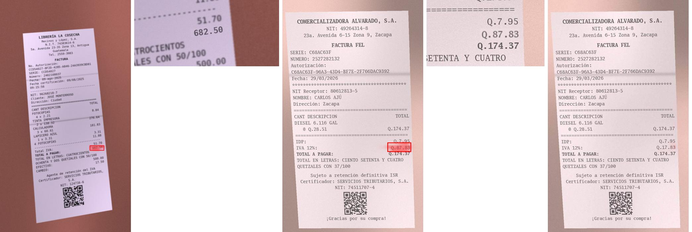

# Resultados

Todas las métricas son sobre el **conjunto de prueba sintético**: 300 facturas auténticas y sus 300 gemelas alteradas, que el modelo no vio al entrenar ni al elegir hiperparámetros. Las figuras y tablas están en [`docs/`](docs/). La evaluación con fotos reales está pendiente (sección final).


*Modelo final (it5) sobre tres fotos de prueba. A la izquierda, el total cambiado de 482.50 a 682.50 (dificultad media). Al centro, el IVA cambiado de 17.83 a 87.83 con la misma fuente (dificultad difícil): el recuadro rojo marca la zona sospechosa, con su acercamiento. A la derecha, una foto auténtica: probabilidad 8.8 %, sin marca.*

## Datos

| | Pares (auténtica + alterada) | Alteraciones fáciles / medias / difíciles |
|---|---|---|
| Entrenamiento | 3,000 | 1,502 / 920 / 578 |
| Validación | 300 | (misma proporción) |
| Prueba | 300 | (misma proporción) |
| Lote extra (it4 e it5) | 3,000 | 903 / 1,036 / 1,061 (con 546 dígitos copiados) |

- **Campos alterados:** total (55 %), NIT del receptor (15 %), fecha (12 %), IVA, NIT del emisor y montos de productos.
- **Técnicas:** reescribir el valor (94 %) o copiar un dígito de la misma factura (6 %).
- **Monto en riesgo:** lo que gana quien altera. Es la diferencia inflada en total o IVA, o el total completo si cambia la fecha (reutilizar una factura vieja) o el NIT (cobrar una compra personal).
- **Las gemelas comparten geometría:** recorte, brillo y escala son los mismos, y solo la compresión JPEG es independiente. Fuera de la zona editada difieren solo por ruido de compresión (2–5 niveles de gris en promedio).

## Iteraciones

| Iteración | Cambio | AUC | Recall con 1 % de falsas alarmas | Recall fácil / medio / difícil* | Localización** | Ahorro (Q / 1,000 facturas)*** | Entrenamiento |
|---|---|---|---|---|---|---|---|
| it1 | EfficientNet-B0, foto reducida a 768×576, promedio global + capa lineal | 0.950 | 82 % | 95 / 92 / 59 % | — (Grad-CAM 25 %) | 7,791 | 40 min |
| it2 | + mapa de sospecha a 1/16, top-8 y supervisión con máscaras | 0.954 | 87 % | 95 / 95 / 56 % | 71 % | 8,643 | 39 min |
| it3 | + **recortes de 512 a resolución completa** de las gemelas | 0.961 | 90 % | 99 / 97 / 66 % | 80 % | 9,000 | 27 min |
| it3b (ablación) | it3 sin supervisión con máscaras | 0.964 | 90 % | 97 / 95 / 61 % | 0 % (Grad-CAM 5 %) | 9,294 | 22 min |
| it4 | it3 + 3,000 pares extra con más casos difíciles (30/35/35 %, más dígitos copiados), 15 épocas | **0.984** | 91 % | 99 / 96 / **80 %** | 79 % | 8,921 | 77 min |
| **it5 (final)** | datos de it4 + **50 % de recortes sin centrar en la edición** + checkpoint elegido por **recall con 1 % de falsas alarmas**, 10 épocas | 0.981 | **93 %** | 99 / 95 / **80 %** | **87 %** | **9,162** | 41 min |
| it6 | it5 + **pérdida ponderada por el monto en riesgo** + checkpoint elegido por **ahorro en validación** | 0.980 | 92 % | 97 / 94 / **81 %** | 80 % | 8,968 | 43 min |

\* Con umbral 0.5. \*\* Porcentaje de fotos alteradas en las que el punto más sospechoso del mapa cae dentro de la zona editada. \*\*\* Con el umbral que maximiza el ahorro **en validación**, aplicado a prueba (ver "Problemas encontrados", punto 4). Los umbrales y el ahorro que se obtendría eligiendo el umbral mirando la prueba están en `docs/comparacion_iteraciones.csv`.

Todos los entrenamientos se hicieron en una RTX 3070 Laptop (8 GB): 10 épocas (15 en it4), AdamW con lr máx. 3e-4 y OneCycle, bf16, y menos de 4 GB de VRAM. La tabla completa está en `docs/comparacion_iteraciones.csv` y las curvas en `docs/curvas_*.png`.

**Incertidumbre:** con 300 alteradas en prueba, un recall cercano al 90 % tiene un intervalo de confianza del 95 % de unos ±3.4 puntos. Una falsa alarma más o menos en prueba mueve el ahorro ~Q100, así que diferencias de ahorro menores a ~Q200–300 no son concluyentes. La mejora de it1 a it2 a it3 es consistente en todas las métricas; entre it3, it3b, it5 e it6 las diferencias de ahorro están dentro del ruido, y por eso las decisiones entre ellas se apoyan también en la localización, las falsas alarmas y el desempeño en casos difíciles.

### Qué aportó cada cambio

- **Resolución completa (it2 → it3)** es el cambio de modelo que más mueve el valor (+Q357 por cada 1,000 facturas) y el recall en las alteraciones difíciles (56 → 66 %). Las huellas de una edición (el borde del parche, el ruido distinto, la fuente que no calza) miden unos pocos píxeles; al reducir la foto a la mitad se pierden. Además, entrenar con recortes es *más rápido* (27 contra 39 minutos).
- **Mapa de sospecha + máscaras (it1 → it2)** mejora poco la detección (+0.004 AUC), pero sube el ahorro +Q852 porque reduce las falsas alarmas a la mitad con umbral 0.5 (3.7 % → 1.7 %) y hace que el modelo señale dónde está la alteración: el mapa acierta la zona en 71 % de los casos, mientras que Grad-CAM sobre el clasificador estándar solo en 25 %.
- **Más casos difíciles (it3 → it4):** es la mejor iteración en métricas técnicas. El AUC sube de 0.961 a 0.984, el recall en alteraciones difíciles de 66 a 80 %, en dígitos copiados de 32 a 63 % y en el IVA de 69 a 85 %. **Pero no genera más valor:** el modelo se vuelve más desconfiado con las facturas auténticas (falsas alarmas con umbral 0.5: 1.7 % → 6.0 %; percentil 95 de la probabilidad en auténticas: 0.11 → 0.62). Para no acusar a empleados honestos hay que usar un umbral alto, y ahí su ventaja se pierde: el ahorro es Q8,921 contra Q9,000 de it3. Con el umbral óptimo de cada uno, lo mismo pasa si se supone un fraude real más sofisticado (30/35/35 %: Q7,936 contra Q8,045), y promediar it3 e it4 tampoco mejora. La validación además alcanzó su mejor AUC en la época 5 y bajó después (sobreajuste al lote difícil). Por eso it4 no reemplazó a it3. Es el ejemplo más claro de que la métrica técnica y el valor de negocio no siempre se mueven juntos.
- **Corregir las falsas alarmas de it4 (it4 → it5):** con los mismos datos se hicieron dos cambios dirigidos al problema de it4. Primero, la mitad de los recortes de entrenamiento caen fuera de la zona editada (antes una cuarta parte), así el modelo ve más ejemplos de "esto es normal". Segundo, el checkpoint se elige por el recall con ≤1 % de falsas alarmas en validación, en vez de por AUC: esa métrica se parece a cómo se usa el modelo. it5 **conserva lo que it4 ganó en fraudes difíciles** (80 % de recall en difíciles, 63 % en dígitos copiados, 85 % en el IVA) y **reduce a la mitad su desconfianza con las auténticas** (falsas alarmas con umbral 0.5: 6.0 % → 3.3 %; percentil 95 en auténticas: 0.62 → 0.29). Logra el mejor recall con 1 % de falsas alarmas (93 %) y la mejor localización (87 %). El ahorro es Q9,162, contra Q9,000 de it3 (con fraude más sofisticado y el umbral óptimo de cada uno: Q8,207 contra Q8,045), aunque esas diferencias están dentro del ruido. **Es el modelo final:** iguala o supera a it3 en valor, es mucho más robusto ante falsificaciones cuidadosas y explica mejor dónde está la alteración.
- **Pérdida ponderada por monto (it5 → it6):** cada alteración pesa en la pérdida según el logaritmo de su monto en riesgo (de 0.3 a 1.9, promedio 1), para que el modelo se enfoque en los fraudes caros; el checkpoint se elige por el ahorro en validación. Mejora un poco en los casos difíciles (81 %, dígitos copiados 68 %), pero **pierde localización (87 → 80 %)** y el umbral elegido en validación no se sostiene en prueba. En validación daba 0.3 % de falsas alarmas y en prueba dio 1.7 %, así que el ahorro baja a Q8,968. Con 300 facturas por clase, el ahorro en validación es demasiado ruidoso para elegir el checkpoint con él (sobreajusta a la validación). Mirando la prueba, it6 hubiera "ganado" (Q9,383): justo lo que el protocolo corregido evita. No cumple los criterios (localización ≥ 85 %, falsas alarmas ≤ 1 %), así que **it5 se mantiene como final**.
- **Ablación sin máscaras (it3b):** detecta igual de bien, pero el mapa **deja de señalar la zona editada** (0 % contra 80 %), y Grad-CAM tampoco (5 %). El modelo detecta sin poder mostrar dónde, y eso le quita al auditor la explicación. La supervisión con máscaras no se justifica por la métrica, sino por la explicabilidad, y por eso el modelo final la mantiene.

### Problemas encontrados y cómo se resolvieron

1. **El primer dataset era imposible.** La mitad de las alteraciones copiaban la fuente, la tinta, el ruido y el desenfoque de la foto. Vistas a 768×576 eran indistinguibles del original, incluso para una persona. Los dos modelos se quedaron en AUC 0.50 (loss 0.693, adivinar). La solución fue etiquetar la dificultad (50 % fácil, 30 % media, 20 % difícil), reportar el recall por nivel y bajar la tasa de aprendizaje de 1e-3 a 3e-4.
2. **El post-proceso desalineaba a las gemelas.** Cada foto se recortaba y reescalaba al azar por separado, y así no se podía recortar la misma ventana de las dos. Ahora comparten geometría (`draw_geometry`).
3. **La validación era 35 veces más lenta que el entrenamiento.** Con `channels_last` + bf16, cuDNN arma un plan de ejecución nuevo por cada tamaño de imagen: 1.2 s por foto contra 35 ms sin `channels_last`. Se quitó `channels_last` y los tamaños se redondean a múltiplos de 128.
4. **El umbral se elegía mirando la prueba.** Hasta it5, el umbral de operación era el que maximizaba el ahorro en el propio conjunto de prueba, lo que infla el resultado (para it5: Q9,298 con umbral 0.80). Ahora el umbral se elige en validación y se aplica a prueba (it5: 0.88 → Q9,162). Todas las iteraciones de la tabla se recalcularon así. La diferencia con el "óptimo mirando la prueba" va de Q11 (it2) a Q415 (it6), y da una idea de cuánto ruido tiene elegir el umbral con 300 facturas por clase.

## Líneas base sin deep learning

| Método | Recall | Falsas alarmas | Ahorro (Q / 1,000) |
|---|---|---|---|
| No revisar nada | 0 % | 0 % | 0 (se pierden Q10,293 de fraude) |
| Auditar todas las facturas | 100 % | 100 % | −19,107 |
| Reglas FEL con **lectura perfecta** de los campos* | 47 % | 14 % | −77 |
| ELA (análisis de nivel de error JPEG) | AUC 0.507 (azar) | | |
| **FacturaSegura (it5, umbral 0.88)** | **92 %** | **0.7 %** | **9,162** |

\* Las validaciones del Proyecto 3 (12/112 del IVA, módulo 11 del NIT, serie y número contra la autorización) aplicadas a los valores que se ven en la foto, suponiendo un OCR perfecto, lo cual favorece a las reglas. Atrapan los totales inflados cuando el IVA no se ajustó, pero no las fechas cambiadas ni un NIT válido de otra persona. Además dan falsas alarmas en facturas legítimas, como las de gasolineras, donde el IDP rompe el 12/112.

ELA no sirve porque todas las fotos, auténticas o no, pasan por recompresión (WhatsApp), lo que borra la huella de la edición.

## Modelo de valor

Por cada 1,000 facturas de reembolso:

```
valor(t) = fraude detenido − costo de auditar las marcadas − fricción con empleados honestos
fraude detenido  = 1000 · prevalencia · E[monto en riesgo · 1(p ≥ t) | alterada]
costo de auditar = 1000 · P(p ≥ t) · Q10           (~10 min de un auditor)
fricción         = 1000 · (1 − prevalencia) · FPR(t) · Q20   (tiempo y molestia del empleado acusado)
```

**Supuestos base:**
- **Prevalencia:** 3 % de las facturas alteradas. Es una estimación; por eso es el parámetro que más se mueve en la sensibilidad.
- **Costos:** Q10 por auditoría y Q20 de fricción por falsa alarma.
- **Monto en riesgo:** sale del propio conjunto de prueba (en promedio Q343 por factura alterada).


**Resultado (it5, umbral 0.88 elegido en validación):** se auditan 34 de cada 1,000 facturas y se detienen Q9,631 de los Q10,293 de fraude (94 %). Restando Q340 de auditoría y Q129 de fricción por las falsas alarmas (0.7 % de las auténticas), el **valor neto es de Q9,162 por cada 1,000 facturas**.

- **Las probabilidades del modelo son muy decididas:** cualquier umbral entre 0.43 y 0.99 da más de Q8,500. Lo que destruye valor son los extremos. Con umbral 0 (auditar todo) se pierden Q19,107, porque la fricción y la auditoría de 970 facturas honestas cuestan más que todo el fraude.
- **Rendimientos decrecientes:** el modelo final ya detiene el 94 % del fraude en quetzales. Aunque llegara al 100 % sin falsas alarmas, el máximo posible sería ≈ Q10,000, apenas +Q800 sobre lo actual. Las iteraciones 3 a 6 lo confirman: el AUC subió de 0.961 a 0.98 y el recall en difíciles de 66 a 80 %, pero el ahorro se movió menos de Q200, dentro del ruido.
- **Dónde se va el resto:** de los ~Q1,100 que separan el ahorro del fraude total, Q662 son fraude no detectado (sobre todo totales con alteración difícil y fechas), Q275 es auditar los fraudes reales (inevitable) y ~Q190 vienen de las falsas alarmas. También se probó una regla que audita según el monto reclamado (probabilidad calibrada × monto en riesgo esperado contra costo de auditar). Atrapa los fraudes caros, pero agrega falsas alarmas, y el ahorro neto quedó igual (Q9,175). Desde aquí, el valor depende más de calibrar bien las probabilidades y de validar los supuestos (prevalencia) que de un modelo más preciso.

**Sensibilidad** (`docs/sensibilidad_it5.csv`; en cada escenario el umbral se vuelve a elegir en validación):

| Escenario | Umbral elegido | Ahorro en prueba (Q / 1,000) | Auditar todo |
|---|---|---|---|
| Base (3 % alteradas) | 0.88 | 9,162 | −19,107 |
| Prevalencia 1 % | 0.96 | 2,991 | −26,369 |
| Prevalencia 5 % | 0.46 | 14,907 | −11,845 |
| Prevalencia 10 % | 0.46 | 30,814 | +6,310 |
| Costo de auditoría −50 % / +50 % | 0.88 | 9,332 / 8,992 | −14,107 / −24,107 |
| Fricción −50 % / +50 % | 0.46 / 0.88 | 8,868 / 9,097 | −9,407 / −28,807 |

- **El umbral se adapta como se espera:** con más fraude (5–10 %) conviene auditar con menos certeza (0.46), y con menos fraude (1 %), con más (0.96).
- **La fricción −50 % da *menos* ahorro, al revés de lo esperado.** Con fricción baja, validación elige 0.46, y en prueba ese umbral deja pasar algunas falsas alarmas más. Es otra muestra del ruido de elegir umbrales con 300 facturas por clase: con una empresa real, el umbral se ajustaría con más datos propios.

El valor es casi proporcional a la prevalencia, y es lo primero que una empresa tendría que estimar con sus propios datos. Auditar todo solo conviene si más del ~8 % de las facturas fueran alteradas.

## Desempeño por tipo de alteración (it5, umbral 0.5; entre paréntesis, it3)

| Campo | Recall | | Técnica | Recall |
|---|---|---|---|---|
| NIT emisor / receptor | 100 % / 100 % | | Reescribir | 96 % (96 %) |
| Total | 94 % (91 %) | | Copiar un dígito | **63 %** (32 %) |
| Fecha | 89 % (92 %) | | | |
| Productos | 86 % (95 %) | | | |
| IVA | 85 % (69 %) | | | |

- **El punto más débil sigue siendo copiar un dígito de la misma factura:** es el mismo trazo, la misma tinta y el mismo ruido, y solo queda un borde de pocos píxeles. Pero mejoró de 32 a 63 % gracias al lote con más casos difíciles.
- **El IVA** (un número chico, en una zona densa de montos) también mejoró: 69 → 85 %.
- **Tickets y facturas carta funcionan igual** (AUC 0.981 en los dos).

## Operación

- **Latencia:** 41 ms por foto en GPU (RTX 3070) y 0.54 s en CPU (8 hilos), incluida la preparación de la imagen (medido con it3; it5 tiene la misma arquitectura). Corre en cualquier laptop sin GPU.
- **Costo por predicción:** ≈ Q0, porque corre local, sin API, y las fotos no salen de la computadora.
- **Tamaño:** EfficientNet-B0 con la cabeza del mapa: 4.1 M de parámetros y 17 MB en disco.

## Pendiente: fotos reales

Las métricas anteriores son sintéticas. Falta medir con fotos reales: facturas auténticas y versiones editadas en el celular con apps comunes (`python -m eval.evaluate --model models/final/best.pt --real eval/real/real.csv`). Es de esperar una caída, sobre todo si las apps usan técnicas que el generador no imita.
